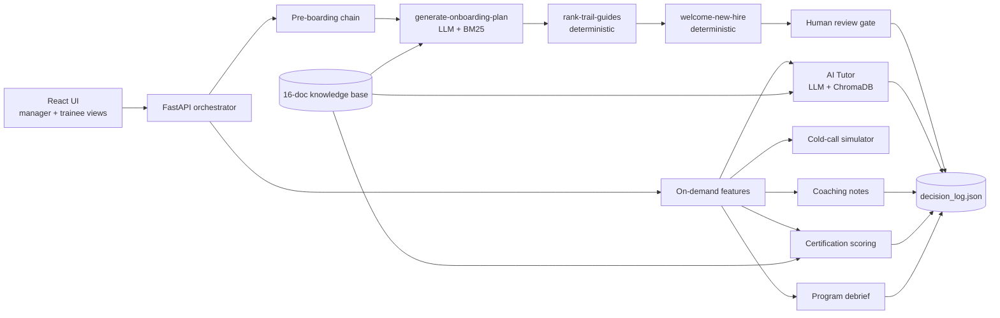

# SDR Onboarding Agent

An agentic AI coworker that takes a new Sales Development Rep from offer letter to certification. It drafts a personalized onboarding plan, matches a mentor, answers product and policy questions with citations, runs practice cold calls, scores real calls, and produces an evidence-backed certification recommendation. Every AI output stops at a human approve / edit / reject / escalate gate, and every decision is logged.

Built with Python, FastAPI, React, RAG (BM25 + ChromaDB), MCP servers, and an LLM evaluation suite in DeepEval.

**Author:** [Shreya Anekar](https://github.com/rsm-sanekar)

---

## The problem

SDR onboarding is slow, manual, and inconsistent. In the baseline process an enablement lead spends around two hours customizing each new hire's plan, managers spend 3 to 5 hours a week reviewing calls with 24 to 72 hour feedback latency, certification is a judgment call with little documented evidence, and nobody captures what worked once a rep ramps.

This project automates the repetitive parts and keeps humans on every decision that matters.

| Step | Manual | With the agent |
|---|---:|---:|
| Build a pre-boarding plan | 90 to 150 min | 10 to 20 min |
| Match a mentor | 20 to 40 min | 5 to 10 min |
| Answer a product or policy question | 10 to 30 min | 1 to 3 min |
| Write a coaching note from a call | 20 to 40 min | 5 to 12 min |
| Certification gap analysis | 45 to 75 min | 10 to 15 min |

Estimates and assumptions are documented in [docs/estimates.md](docs/estimates.md).

---

## Architecture



**Pre-boarding chain.** Three steps hand off through a shared JSON envelope (`status`, `next_action`, `confidence`, `review_required`, `artifact_refs`, `outputs`). The orchestrator follows `next_action` and pauses at a review gate when confidence drops below 0.60.

**On-demand features.** Used across the 12-week ramp: the AI Tutor, cold-call simulation with a scored debrief, coaching notes from real transcripts, certification gap analysis, and a post-certification program debrief.

Full process design, risk analysis, and the human-review map are in [docs/architecture.md](docs/architecture.md) and the one-page [process design PDF](docs/process_design.pdf). The project walkthrough deck is in [presentation_slides/](presentation_slides/SDR_Onboarding_AI_Coworker.pdf).

---

## Key features

- **7 LLM skills and 2 deterministic automations.** LLM calls are used only where judgment is needed. Mentor ranking (a transparent 5-component score) and the welcome email are plain Python.
- **Two retrievers over one corpus.** BM25 for machine-generated queries in the chain skills, ChromaDB semantic search for free-form questions in the Tutor. Approved Tutor answers are written back into the vector index.
- **Hallucination guards.** Generated plans are checked against a Trailhead module allow-list before they are saved. Certification verdicts are recomputed server-side from the dimension scores, and any mismatch with the LLM's own verdict is flagged for the trainer.
- **Cited, auditable answers.** Every output carries the retrieved passages and scores behind it, and the UI shows them inline next to the answer.
- **Human in the loop by design.** Five explicit review gates. The AI recommends; the manager or trainer decides. See [docs/human_review_plan.md](docs/human_review_plan.md).
- **MCP integration.** Two FastMCP servers expose the hire and mentor data as resources and the core workflow steps as callable tools, so an agent like Claude Code can drive the workflow directly.
- **Role-aware UI.** 9 screens across manager and trainee views.

---

## Evaluation

**153 pytest tests** run fully offline by mocking LLM responses, covering every skill, automation, retriever, MCP server, and the orchestrator.

**DeepEval suite for the AI Tutor:** 10 cases across normal, vague, out-of-scope, and confidently-incomplete questions, each scored on 4 metrics (citation and next step, faithfulness, answer relevancy, SDR face validity). I ran it 3 times before and 3 times after a targeted prompt change:

| | Mean passes (of 40) | Range across runs |
|---|---:|---:|
| Before | 21.3 | 3 |
| After | 23.3 | 1 |

The change lifted the mean and made results far more consistent run to run. Case-level analysis is in [docs/test_report.md](docs/test_report.md), and predicted failure modes with their mitigations are in [docs/failure_cases.md](docs/failure_cases.md).

---

## Tech stack

| Layer | Tools |
|---|---|
| Backend | Python 3.12, FastAPI, Pydantic, Polars |
| LLM | OpenAI-compatible client (any gateway), structured JSON output with schema validation |
| Retrieval | rank-bm25, ChromaDB |
| Agent tooling | MCP (FastMCP), Claude Code skills |
| Frontend | React, Vite, Tailwind CSS |
| Testing | pytest, DeepEval, ruff |
| Packaging | uv |

---

## Run it locally

```bash
uv sync
uv run pytest -q          # offline test suite
```

To use a real model, copy `.env.example` to `.env` and set `LLM_API_KEY` and `LLM_API_BASE` for any OpenAI-compatible endpoint.

```bash
# terminal 1: API on http://localhost:8000
uv run python workflow_server.py

# terminal 2: UI on http://localhost:5173
cd ui && npm install && npm run dev
```

Pick a role in the navbar and walk through the tabs.

Run the pre-boarding chain from the command line, offline:

```bash
MOCK_LLM_RESPONSE='{"summary":"...","weeks":[],"subject":"Welcome aboard!","body":"...","confidence":0.92}' \
  uv run python scripts/orchestrator.py --hire-id HIRE-001
```

Run the DeepEval suite (calls a real model):

```bash
uv run --env-file .env python -m tests.eval_suite.test_tutor_quality
```

---

## Repository layout

```
├── workflow_server.py     # FastAPI orchestrator, review gates, decision logging
├── skills/                # 7 LLM skills (SKILL.md + script each)
├── automations/           # 2 deterministic steps
├── mcp_servers/           # FastMCP data + tools servers
├── rag/                   # knowledge base, BM25 and ChromaDB retrievers
├── scripts/               # CLI orchestrator, knowledge-base scraper
├── utils/                 # LLM client, shared step infrastructure
├── ui/                    # React + Vite + Tailwind
├── tests/                 # pytest suite + DeepEval eval_suite
├── data/                  # synthetic hires, mentors, SDR cohort, decision log
├── docs/                  # architecture, process design PDF, review plan, estimates, evaluation
└── presentation_slides/   # project walkthrough deck (PDF + Quarto source)
```

---

## A note on the data

All company data is synthetic. The knowledge base simulates internal onboarding material for a Salesforce-style SDR team (policy codes, ramp schedules, rubrics, named owners) so retrieval can be tested on details a model could not know from public training data. Seven public Wikipedia pages are included as background reference.
